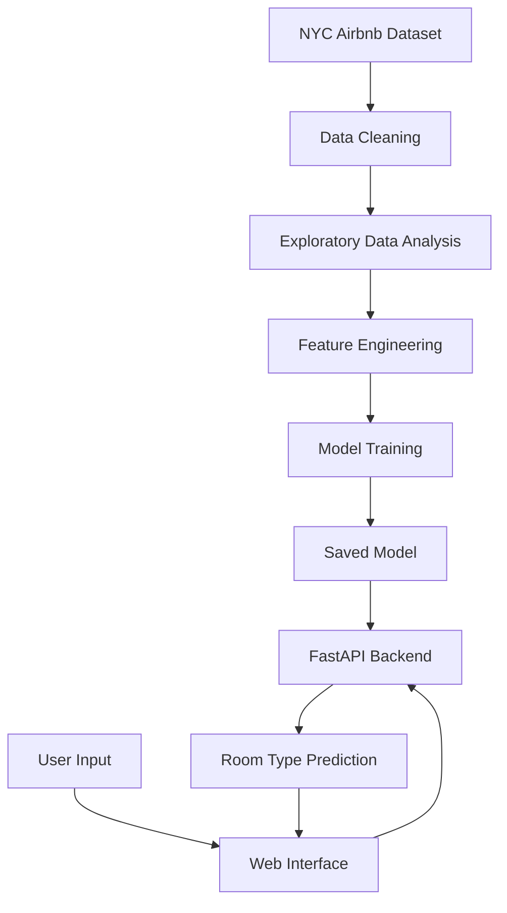

# 🏠 NYC Airbnb Room Type Predictor

An end-to-end Machine Learning project that predicts Airbnb room types in New York City using listing features. The project combines a trained classification model, a FastAPI backend, and a web interface to demonstrate how machine learning models can be served through an API.

## 🌐 Live Demo

🚀 **Live Application:** [NYC Airbnb Room Type Predictor](https://nyc-airbnb-room-type-prediction-1-1k3t.onrender.com/)

Try the deployed application to explore the room-type prediction workflow.

> Note: The hosted service may take a little time to respond after a period of inactivity.

## ✨ Features

- 🤖 **Machine Learning Prediction:** Predicts the room type of an Airbnb listing.
- 🏡 **Multiclass Classification:** Supports room categories represented in the trained model, such as Entire home/apt, Private room, and Shared room.
- ⚡ **FastAPI Backend:** Exposes a prediction endpoint for model inference.
- 🌐 **Web Interface:** Provides a user-facing interface for submitting listing information.
- 📊 **Exploratory Data Analysis:** Includes a notebook for examining the dataset and developing the model.
- 💾 **Model Persistence:** Loads a saved model artifact for predictions.
- ☁️ **Cloud Deployment:** Hosted on Render.

## 🛠️ Tech Stack

| Technology | Purpose |
|---|---|
| Python | Core programming language |
| Pandas | Data manipulation and analysis |
| NumPy | Numerical computing |
| Scikit-learn | Machine learning and classification |
| Jupyter Notebook | Data exploration and model development |
| FastAPI | Backend API |
| Uvicorn | ASGI server |
| HTML, CSS, JavaScript | Web interface |
| Render | Application hosting |

## 📊 Dataset

This project uses the New York City Airbnb Open Data dataset.

The dataset contains Airbnb listing information, including geographical location, room type, price, minimum nights, reviews, and availability.

**Dataset resources:**
- [NYC Airbnb Open Data — Kaggle](https://www.kaggle.com/datasets/dgomonov/new-york-city-airbnb-open-data)
- [Inside Airbnb — Data Downloads](https://insideairbnb.com/get-the-data/)

The actual features used for training and inference depend on the preprocessing and model implementation in this repository.

## 🏗️ Project Workflow



## 📂 Project Structure

```text
NYC-Airbnb-Room-Type-Predictor/
├── main.py
├── requirements.txt
├── *.ipynb
├── model artifact
├── frontend files
└── README.md
```

- `main.py` — FastAPI application.
- `requirements.txt` — Python dependencies.
- Jupyter notebook — Data analysis and model development.
- Model artifact — Saved trained model.
- Frontend files — User interface, where included.
- `README.md` — Project documentation.

Actual filenames and paths may differ; retain the structure used by the repository.

## ⚙️ Run Locally

### Prerequisites

- Python installed on your system.
- Git.
- Visual Studio Code.

### 1. Clone the repository

```bash
git clone https://github.com/Fajlurrahman219/NYC-Airbnb-Room-Type-Predictor.git
cd NYC-Airbnb-Room-Type-Predictor
```

### 2. Create a virtual environment

**Windows PowerShell**

```powershell
py -m venv .venv
.\.venv\Scripts\Activate.ps1
```

If PowerShell blocks activation, run:

```powershell
Set-ExecutionPolicy -Scope Process -ExecutionPolicy Bypass
.\.venv\Scripts\Activate.ps1
```

### 3. Install dependencies

```powershell
python -m pip install --upgrade pip
python -m pip install -r requirements.txt
```

### 4. Start the FastAPI server

If `main.py` defines the FastAPI application as `app`, run:

```powershell
python -m uvicorn main:app --reload
```

The local API will normally be available at:

http://127.0.0.1:8000

Open the interactive API documentation at:

http://127.0.0.1:8000/docs

### 5. Open the application

Visit the [live Render application](https://nyc-airbnb-room-type-prediction-1-1k3t.onrender.com/) or use the local frontend according to the project's configuration.

## 🔌 API Documentation

The FastAPI backend provides a prediction endpoint.

Once the application is running locally, visit:

http://127.0.0.1:8000/docs

Use the interactive documentation to inspect the available routes, required input fields, request format, and prediction response.

The exact request schema should be taken from the application's implementation rather than assumed from example listing features.

## 🧪 Model Evaluation

The notebook contains the data analysis and model development workflow.

Recommended evaluation metrics include:

- Accuracy
- Precision
- Recall
- F1-score
- Confusion matrix

These metrics help assess classification performance, including performance across individual room categories.

Actual evaluation scores should be reported only after verifying the model's results on held-out data.

## 🐛 Troubleshooting

### Missing Python dependencies

Activate the correct virtual environment and install the dependencies:

```powershell
python -m pip install -r requirements.txt
```

### Uvicorn is not recognized

Run Uvicorn through Python:

```powershell
python -m uvicorn main:app --reload
```

### Model file not found

Confirm that the trained model artifact exists at the path expected by the backend. Run the server from the project root when required.

### Invalid prediction input

Check that the supplied feature names, types, and values match the API schema and the preprocessing pipeline used during training.

### Render application is slow to respond

A hosted service may need time to start after inactivity. Wait briefly and retry. If the problem persists, inspect the deployment logs on Render.

## ⚠️ Limitations

- Predictions depend on the quality and representativeness of the training data.
- Listing patterns can change over time.
- Model performance may vary across neighbourhoods and room categories.
- Predictions are estimates and are not guarantees of listing availability, quality, or price.
- The deployed application's availability depends on the hosting configuration.

## 🔐 Responsible Use

- Follow the dataset's licensing and usage terms.
- Do not publish sensitive data or credentials.
- Document model limitations and evaluation results.
- Avoid interpreting predicted room types as verified information about an actual listing.

## 🚀 Future Improvements

- Add automated unit and integration tests.
- Publish verified model evaluation results.
- Improve input validation and API error handling.
- Add prediction confidence information where statistically appropriate.
- Improve model monitoring and retraining workflows.
- Add more detailed prediction explanations.
- Expand deployment monitoring and logging.

## 🤝 Contributing

Contributions and suggestions are welcome.

1. Fork the repository.
2. Create a feature branch.
3. Make your changes.
4. Test the changes locally.
5. Submit a pull request describing the improvements.

## 📜 License

Add a `LICENSE` file before specifying a license. Until then, do not assume unrestricted reuse or redistribution rights.

## 📚 References

- [NYC Airbnb Open Data — Kaggle](https://www.kaggle.com/datasets/dgomonov/new-york-city-airbnb-open-data)
- [Inside Airbnb](https://insideairbnb.com/)
- [Scikit-learn Documentation](https://scikit-learn.org/stable/)
- [FastAPI Documentation](https://fastapi.tiangolo.com/)
- [Render Documentation](https://render.com/docs)

---

**Built with Python, Scikit-learn, FastAPI, and Render.**
